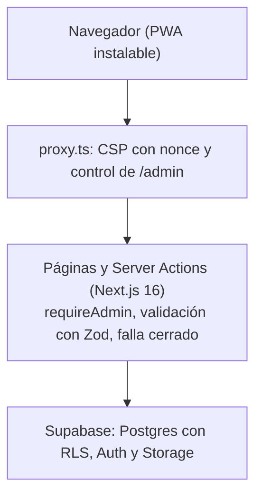

# Akira Astrum: blog de astrología con intranet de administración, desarrollado con IA, TDD y seguridad OWASP

**Memoria del Trabajo Final de Máster**

- **Autor:** Ivan Maldonado
- **Máster, universidad y tutor:** `[por completar]`
- **Fecha de entrega:** viernes 6 de noviembre de 2026
- **Aplicación desplegada:** https://akira-astrum.vercel.app/
- **Diapositivas de la defensa:** https://nikaivan.github.io/Akira_Astrum/
- **Repositorio:** https://github.com/nikaivan/Akira_Astrum

> Esta memoria se redacta a partir de los documentos del repositorio (`PLAN.md`, `docs/`, el código y sus tests). Cada cifra procede de una ejecución o de un archivo del proyecto. Lo que solo puede aportar el autor figura entre corchetes.

## Índice

1. [Introducción](#1-introducción)
2. [Metodología](#2-metodología)
3. [Análisis y diseño](#3-análisis-y-diseño)
4. [Implementación](#4-implementación)
5. [Seguridad](#5-seguridad)
6. [Pruebas y calidad](#6-pruebas-y-calidad)
7. [Despliegue](#7-despliegue)
8. [Uso de la inteligencia artificial](#8-uso-de-la-inteligencia-artificial)
9. [Cumplimiento de objetivos y limitaciones](#9-cumplimiento-de-objetivos-y-limitaciones)
10. [Conclusiones y trabajo futuro](#10-conclusiones-y-trabajo-futuro)
11. [Referencias](#referencias)
12. [Anexos](#anexos)

---

## 1. Introducción

### 1.1 Contexto y problema

Un blog de astrología necesita dos zonas con exigencias opuestas: un público que solo lee y una zona de administración protegida donde una sola persona crea y publica el contenido. A ello se suma una herramienta pública, una calculadora de compatibilidad entre signos, que maneja un dato personal (la fecha de nacimiento) y no debe guardarlo. Y se pide que todo funcione en móvil y escritorio y que pueda instalarse como aplicación.

El trabajo tiene además un objetivo metodológico: comprobar hasta dónde se puede delegar la implementación en una inteligencia artificial (Claude Code) manteniendo la calidad y la seguridad, con el humano como **arquitecto y tester**.

### 1.2 Objetivos

Según `PLAN.md` §1, la aplicación incluye:

- **Blog público de solo lectura:** listado de entradas publicadas, detalle y categorías. Sin registro de usuarios.
- **Intranet de administración:** acceso exclusivo del administrador, que crea, edita, publica, despublica y elimina entradas y categorías, y sube imágenes (portada e imágenes dentro del contenido) a Supabase Storage.
- **Calculadora de compatibilidad:** pública y sin cuentas. Dadas dos fechas de nacimiento, devuelve la compatibilidad entre signos solares con una explicación. No se registra ni se guarda ningún dato.
- **Aplicación web responsive e instalable (PWA):** diseño móvil primero, con un alcance PWA mínimo: manifiesto, iconos y página sin conexión.

Los estados de una entrada son `borrador ↔ publicado`. Plazo: entrega el viernes 6 de noviembre. Coste: 0 €.

### 1.3 Fuera de alcance

Registro público, perfiles y emparejamiento entre usuarios, cartas astrales completas, notificaciones push, sincronización sin conexión, caché de contenido de la intranet, comentarios, otros roles, newsletter, multiidioma, galerías, edición de imágenes y pagos.

---

## 2. Metodología

### 2.1 TDD estricto

Cada funcionalidad sigue el ciclo de `PLAN.md` §3 y del [ADR 0002](adr/0002-tdd-estricto-roles-humano-ia.md):

1. **Rojo:** el humano define el criterio de aceptación, se escribe el test y se comprueba que falla.
2. **Verde:** la IA implementa lo mínimo para pasarlo.
3. **Refactor:** se limpia el código con los tests en verde.
4. **Commit** por ciclo (`test:`, `feat:`, `refactor:`), solo tras la aprobación del humano.

Reglas: la IA no modifica un test aprobado sin permiso expreso; la pirámide tiene muchos tests unitarios, algunos de integración (RLS y Storage contra Supabase) y pocos e2e; los tests de permisos y de seguridad no son un añadido final.

### 2.2 Reparto de roles

| Rol | Responsabilidades |
|---|---|
| **IA (implementadora)** | Propone el plan y la lista de tests de cada bloque, escribe los tests aprobados, implementa lo mínimo, refactoriza, redacta los ADR y las entradas del registro de uso de IA, y verifica con `next build` y un navegador real. |
| **Humano (arquitecto)** | Fija las reglas del proceso, aprueba cada plan, test y commit, decide en los puntos ambiguos y acepta cada ADR. |
| **Humano (tester)** | Ejecuta la integración contra Supabase real, los e2e, el escaneo ZAP y la comprobación del despliegue, y detecta fallos que las suites no veían. |

### 2.3 Flujo de trabajo por sub-bloque

Cada bloque seguía cuatro pasos: **plan** (se espera aprobación), **tests en rojo** (se espera aprobación), **mínimo en verde** y **refactor**, con una nota de qué anotar en el registro de IA y qué ADR hace falta. Las reglas de seguridad del proceso eran fijas: nunca leer ni imprimir archivos `.env*`; integración y e2e solo contra un proyecto de Supabase de test, con una guarda que aborta si la URL no coincide; la clave `service_role` jamás en el código de la aplicación. Las integraciones en `main` se hacían mediante pull requests con la CI en verde.

---

## 3. Análisis y diseño

### 3.1 Stack

Decisión: **monolito** ([ADR 0001](adr/0001-monolito-nextjs-supabase.md)).

| Capa | Tecnología |
|---|---|
| Framework | Next.js 16 (App Router) con TypeScript y React 19 |
| Base de datos y autenticación | Supabase (Postgres, Auth, RLS) |
| Validación | Zod |
| Interfaz | Tailwind CSS v4 y shadcn/ui |
| Contenido | Markdown renderizado y sanitizado (`react-markdown` y `rehype-sanitize`) |
| Imágenes | Supabase Storage (lectura pública, escritura solo del administrador) |
| PWA | `app/manifest.ts`, iconos y service worker mínimo propio |
| Tests | Vitest (unitarios e integración) y Playwright (e2e) |
| CI y despliegue | GitHub Actions, Vercel y Supabase (planes gratuitos) |

### 3.2 Arquitectura

Cada salto repite la comprobación de acceso ([ADR 0003](adr/0003-seguridad-en-profundidad-rls-y-servidor.md) y [ADR 0010](adr/0010-autorizacion-en-capas-proxy-requireadmin-y-rls.md)): el proxy, `requireAdmin` en cada página y acción, y las políticas RLS de la base de datos. Si una capa falla, la siguiente deniega.

### 3.3 Modelo de acceso y de datos

| Actor | Leer publicadas | Leer borradores | Crear, editar, publicar y borrar |
|---|---|---|---|
| Visitante anónimo | Sí | No | No |
| Usuario autenticado sin rol admin (no debería existir) | Sí | No | No |
| Administrador | Sí | Sí | Sí |

El rol vive en `public.profiles.role` y lo determina `private.is_admin()`, una función `SECURITY DEFINER` con `search_path` vacío que no lee el JWT ([ADR 0008](adr/0008-control-de-acceso-rol-en-profiles-y-storage-no-listable.md)). Nadie escribe en `profiles` por la API: el administrador se crea a mano con SQL. Las tablas son `profiles`, `categories`, `posts` y `post_categories`, definidas en cuatro migraciones (`supabase/migrations/`): esquema, control de acceso, Storage y `cover_alt`. La base de datos repite como `CHECK` las reglas de la aplicación (slug, longitud del título, `published_at` ligado al estado y forma del nombre de la portada). Se concede el mínimo privilegio: se revoca todo a `anon` y `authenticated` y se concede solo lo necesario, con privilegios por columna.

### 3.4 Estructura del proyecto

| Carpeta | Contenido |
|---|---|
| `app/` | Rutas: blog, categorías, compatibilidad, login, admin, offline y manifiesto |
| `components/` | Interfaz; `components/admin/` para el panel |
| `lib/` | Lógica por dominios: `admin`, `astrology`, `auth`, `blog`, `compatibility`, `markdown`, `posts`, `pwa`, `security`, `storage`, `supabase` |
| `proxy.ts` | CSP con nonce y control de `/admin` |
| `supabase/migrations/` | Esquema, políticas RLS, Storage y `cover_alt` |
| `tests/` | `unit/`, `integration/` y `e2e/` |
| `docs/` | Diseño, reglas astrológicas, ADR, modelo de amenazas, checklist OWASP, registro de IA y esta memoria |

### 3.5 Diseño visual

La guía está en `docs/design.md` y el [ADR 0018](adr/0018-identidad-visual-noche-y-marfil-tokens-por-superficie-y-adornos-propios.md): dos superficies con los mismos nombres de token, **marfil** (lectura, formularios y todo el panel) y **noche** (cabecera, pie, portada y bandas de título); tipografía Cormorant Garamond para los títulos e Inter para el cuerpo, servidas con `next/font`; y adornos propios en SVG. Los contrastes se comprueban con la fórmula de WCAG 2 mediante un test que lee `globals.css`, y los e2e con axe vigilan la accesibilidad. El diseño es móvil primero, sin desbordes a 320 px y con objetivos táctiles de al menos 44 px.

### 3.6 Reglas de la calculadora

Las reglas están en `docs/astrologia-reglas.md`, validadas por el autor el 2026-11-02: tabla de 12 signos, 66 parejas, niveles de compatibilidad, excepciones por pareja, precedencia y textos explicativos. Son convenciones de la tradición astrológica, sin base científica, y así se indica en la interfaz y en el README. El dominio vive en funciones puras (`lib/astrology/`) y trata las fechas sin zona horaria ([ADR 0007](adr/0007-dominio-astrologico-fuente-de-verdad-simetria-y-fechas-sin-zona-horaria.md)).

---

## 4. Implementación

El desarrollo se realizó entre el 2 y el 5 de noviembre de 2026, en cuatro fases (`PLAN.md` §8). Cada bloque dejó una entrada en `docs/ai-log.md` y, cuando hubo una decisión de arquitectura, un ADR.

| Fase | Contenido | Decisiones principales |
|---|---|---|
| **0. Preparación** | Proyecto Next.js, Vitest, Playwright, cliente de Supabase, CI y ADR 0001–0005 | Monolito, TDD, versiones fijas |
| **1. Dominio y acceso** | Slugs y estados, dominio astrológico, esquema con RLS, login del administrador | ADR 0006–0011 |
| **2. Producto** | Calculadora, blog con Markdown sanitizado, CRUD del panel, portada, imágenes en el contenido, identidad visual | ADR 0012–0018 |
| **3. Endurecimiento** | CSP, límites y registro de eventos, cadena de suministro, PWA, escaneo ZAP | ADR 0019–0023 |
| **4. Documentación y despliegue** | README, resumen final, despliegue en Vercel y esta memoria | — |

### 4.1 Blog público

Páginas `/`, `/blog`, `/blog/[slug]` y `/categorias/[slug]`. Las páginas públicas no usan caché y leen con un cliente anónimo sin cookies; borrador, entrada despublicada y slug inexistente dan el mismo 404 ([ADR 0014](adr/0014-lectura-publica-sin-cache-cliente-anonimo-y-404-unico.md)). El Markdown se sanitiza con una lista blanca explícita, sin HTML crudo, con enlaces limitados a `http`, `https` y `mailto`, e imágenes solo del Storage del proyecto ([ADR 0013](adr/0013-markdown-publico-sanitizado-react-markdown-y-lista-blanca-explicita.md)).

### 4.2 Intranet

Acceso en `/login` y panel en `/admin`. Un único mensaje de error en el login para cualquier fallo, límite de 5 fallos cada 15 minutos, cookies `httpOnly`, `sameSite: lax` y de 8 horas, y un destino tras el login restringido a `/admin` ([ADR 0011](adr/0011-login-y-sesion-mensaje-unico-limitador-en-memoria-y-cookies.md)). Las nueve Server Actions del panel comprueban al administrador en cada llamada, usan esquemas Zod estrictos, fijan en el servidor lo que el cliente no decide y compensan los fallos en lugar de usar transacciones ([ADR 0015](adr/0015-mutaciones-del-panel-esquemas-estrictos-withadminaction-y-compensacion.md)). `published_at` queda ligado al estado y las transiciones son estrictas ([ADR 0006](adr/0006-publicacion-published-at-y-transiciones-estrictas.md)).

### 4.3 Imágenes

La portada y las imágenes del contenido se suben por una Server Action con la sesión del administrador, nunca con `service_role`. El tipo se valida por el contenido del archivo (firma y estructura), no por el nombre ni por el `Content-Type`; solo JPEG, PNG y WebP; tamaño máximo de 2 MiB; el servidor genera el nombre (UUID); el texto alternativo es obligatorio; y hay un límite de 20 subidas cada 10 minutos. Se limpian las imágenes huérfanas al borrar una entrada o al cambiar una imagen ([ADR 0016](adr/0016-subida-de-la-portada-validacion-por-contenido-nombre-generado-y-compensacion.md) y [ADR 0017](adr/0017-imagenes-en-el-contenido-accion-de-subida-propia-y-limpieza-acotada-de-huerfanas.md)).

### 4.4 Calculadora

La página `/compatibilidad` envía las fechas por POST a una Server Action, que las valida con Zod en el servidor, calcula y responde sin guardar ni registrar nada. Hay un límite de 30 consultas cada 10 minutos por instancia ([ADR 0012](adr/0012-calculadora-publica-sin-persistencia-server-action-post-y-limite-en-memoria.md)). Un aviso visible indica que se basa en convenciones de la tradición astrológica, sin base científica.

### 4.5 PWA y responsive

Manifiesto con iconos (uno enmascarable), `display: standalone` y color de tema noche. El service worker es mínimo ([ADR 0022](adr/0022-pwa-minima-manifiesto-service-worker-que-solo-sirve-la-pagina-sin-conexion-y-nunca-guarda-contenido.md)): solo sirve una página `/offline` autocontenida cuando no hay red y **nunca guarda contenido**; no intercepta `/admin`, `/login`, las Server Actions ni las peticiones autenticadas. Instalación: en Android, con Chrome, menú → «Instalar aplicación»; en iOS, con Safari, Compartir → «Añadir a pantalla de inicio»; en escritorio, con Chrome o Edge, el icono de la barra de direcciones.

`[Capturas del panel de administración: por completar por el autor]`

### 4.6 Desviaciones respecto al plan

Se registran en `docs/ai-log.md` y en los ADR, sin reescribir `PLAN.md`. Las principales:

- Las rutas del blog son `/blog/[slug]` y `/categorias/[slug]`, no `/posts/[slug]`, y el panel vive en `app/admin/` sin grupos de rutas.
- Se añadió la columna `cover_alt` (migración 4) para el texto alternativo obligatorio de la portada.
- `serverActions.bodySizeLimit` pasa a 3 MB, porque el límite por defecto (1 MB) impedía subir una portada válida de 2 MiB.
- Todas las páginas se renderizan en cada petición (`force-dynamic`), porque un nonce de CSP distinto en cada petición solo se puede aplicar al renderizar.
- La CSP admite `style-src-attr 'unsafe-inline'`, una excepción acotada que necesita `next/image`.
- El registro de eventos (A09) no incluye las acciones del administrador que cita el plan.
- Se añadió `.github/dependabot.yml`, que el plan citaba pero no existía.
- El pulido visual se hizo en un bloque propio y con cambio de paleta.
- El escaneo ZAP lo ejecuta el arquitecto en su equipo, porque el entorno de la IA no puede ejecutar Docker.

---

## 5. Seguridad

### 5.1 Resumen OWASP Top 10:2025

El detalle, medida por medida y con la evidencia que la demuestra, está en [`docs/owasp-checklist.md`](owasp-checklist.md). Un test comprueba que cada ruta que cita existe y que lo no hecho figura en su resumen. En total son **57 medidas: 48 hechas, 4 parciales y 5 no hechas**.

| Categoría | Medidas hechas | Evidencia clave |
|---|---|---|
| A01 Control de acceso | 5 de 5 | RLS en `…_access_control.sql`; `tests/integration/posts-unprivileged.test.ts` |
| A02 Configuración de seguridad | 8 de 9 | `lib/security/csp.ts`; `tests/unit/security/csp.test.ts` |
| A03 Cadena de suministro | 4 de 6 | `tests/unit/supply-chain/dependencies.test.ts`; ADR 0021 |
| A04 Fallos criptográficos | 5 de 5 | `.gitignore`; `tests/unit/auth/architecture.test.ts` |
| A05 Inyección | 7 de 7 | `lib/markdown/sanitize-schema.ts`; `tests/unit/markdown/sanitize.test.ts` |
| A06 Diseño inseguro | 4 de 4 | `docs/threat-model.md` |
| A07 Fallos de autenticación | 5 de 7 | `lib/auth/rate-limit.ts`; `tests/unit/auth/rate-limit.test.ts` |
| A08 Integridad de software y datos | 4 de 6 | `.github/workflows/ci.yml` |
| A09 Registro y alertas | 2 de 4 | `lib/security/events.ts`; `tests/unit/security/events.test.ts` |
| A10 Condiciones excepcionales | 4 de 4 | `lib/auth/authorize.ts`; `tests/unit/auth/authorize.test.ts` |

### 5.2 Modelo de amenazas

`docs/threat-model.md` aplica un STRIDE ligero: activos (cuenta del administrador, entradas, imágenes, fechas de la calculadora, secretos), actores y límites de confianza (navegador → servidor Next.js → Supabase) y trece amenazas con su mitigación, cada una enlazada a la medida OWASP donde se define y se prueba. Los riesgos aceptados son un único administrador, la infraestructura de Vercel y Supabase fuera de alcance, y los avisos moderados de las herramientas de desarrollo. Fue revisado y aprobado por el autor el 2026-11-05.

### 5.3 Endurecimiento

- **CSP y cabeceras** ([ADR 0019](adr/0019-csp-con-nonce-por-peticion-excepcion-de-estilos-en-atributos-y-cabeceras-estaticas.md)): CSP con nonce por petición y `strict-dynamic`, sin `unsafe-inline` en scripts; cabeceras estáticas (`X-Frame-Options`, `Referrer-Policy`, `Permissions-Policy`, `Cross-Origin-Opener-Policy`, `Cross-Origin-Resource-Policy`, HSTS en producción); `X-Powered-By` desactivado.
- **Registro de eventos** ([ADR 0020](adr/0020-registro-de-eventos-de-seguridad-sin-datos-personales-limites-en-serverless-y-fallo-cerrado.md)): vocabulario cerrado de eventos con lista blanca de campos y un identificador de cliente con sal por instancia; no se registran correos, contraseñas ni fechas. El registro nunca altera la respuesta.
- **Fallo cerrado:** si falla la sesión, el rol o Supabase, se deniega; los mensajes son genéricos y verificados en las nueve acciones del panel.
- **Cadena de suministro** ([ADR 0021](adr/0021-cadena-de-suministro-versiones-exactas-lista-de-dependencias-revisadas-y-auditoria-en-la-ci.md)): versiones exactas, comprobación de integridad del lockfile, lista de dependencias revisadas que fuerza a revisar cualquier paquete nuevo, `npm audit` en la CI (`--omit=dev` sin ningún aviso) y Dependabot agrupado en menores y parches. `shadcn` pasó a dependencia de desarrollo.
- **CSRF:** las Server Actions comparan `Origin` con `Host` y las cookies son `sameSite: lax`; un e2e comprueba que se rechaza un origen ajeno.

### 5.4 Escaneo ZAP

OWASP ZAP 2.17.0 en modo baseline, contra un build de producción local y solo el proyecto de test (`npm run zap`), el 2026-11-04. Se hizo dos veces. El primer escaneo detectó una alerta baja de `Cross-Origin-Resource-Policy`, que se corrigió con `same-origin` (primero el test, después la cabecera). El segundo: **0 alertas altas**, 1 media (ausencia de token CSRF, evaluada y aceptada con evidencia), 1 baja (`Cross-Origin-Embedder-Policy`, aceptada) y 5 informativas; 63 reglas superadas. Límites: es un análisis pasivo y sin sesión, no escanea la intranet (cubierta por integración y e2e), y su rastreo envía formularios, por eso solo se ejecuta contra el proyecto de test.

---

## 6. Pruebas y calidad

### 6.1 Niveles

| Nivel | Qué comprueba | Cómo se ejecuta | Resultado |
|---|---|---|---|
| **Unitarios** | Dominio, validaciones, seguridad, PWA, documentos | `npm test` | **2441 tests** en 102 archivos |
| **Integración** | Esquema, RLS y Storage contra la API real de un proyecto de Supabase de test | `npm run test:integration` | 13 archivos; en verde al cierre del desarrollo (ejecutados por el autor) |
| **e2e** | Flujos críticos en escritorio y en Pixel 7, con accesibilidad (axe) | `npm run test:e2e` | 13 specs; en verde al cierre del desarrollo (ejecutados por el autor) |

Los tests de integración y e2e abortan antes de hacer ninguna petición si la URL de Supabase no es exactamente la del proyecto de test ([ADR 0009](adr/0009-pruebas-de-integracion-proyecto-de-test-y-service-role-acotado.md) y [ADR 0004](adr/0004-playwright-escritorio-y-movil.md)). `service_role` solo se usa en el soporte de pruebas, para crear y borrar datos temporales.

### 6.2 Integración continua

El flujo `.github/workflows/ci.yml` se ejecuta en cada pull request y en `main`: `npm ci`, `npm run lint`, `npm test`, `npm audit --audit-level=high` y `npm audit --omit=dev`. No ejecuta la integración ni los e2e (necesitan el proyecto de test) ni `next build`; el autor los ejecuta antes de cada fusión. El lint (ESLint con `eslint-plugin-security`) termina con 0 errores.

### 6.3 Qué detectaron las pruebas

Los tests destaparon fallos reales, algunos de la propia IA: suposiciones equivocadas en sus tests de integración, un script de ZAP que fallaba en silencio con el formato real del `.env` del autor, páginas estáticas sin nonce de CSP y los estilos de `next/image` que solo se ven en un build de producción, y un `favicon.ico` sin canal alfa que rompía el `next build`. Los detalles están en `docs/ai-log.md`.

---

## 7. Despliegue

La aplicación está desplegada en Vercel, con Supabase como base de datos, autenticación y almacenamiento (ambos en plan gratuito): https://akira-astrum.vercel.app/.

- **Variables de entorno de producción:** `NEXT_PUBLIC_SUPABASE_URL` y `NEXT_PUBLIC_SUPABASE_ANON_KEY`. `SUPABASE_SERVICE_ROLE_KEY` **no** se define en Vercel, porque el código de la aplicación no la usa.
- **Antes de desplegar:** aplicar las cuatro migraciones en la base de datos de producción (sin la utilidad SQL exclusiva de test), desactivar el registro público y crear el perfil del administrador. El README documenta el procedimiento.
- **Comprobaciones previas:** `npm ci`, lint, tests y `next build` correctos; el historial de Git solo contiene `.env.example` (sin valores) y ninguna clave real.
- **Comprobaciones en producción**, hechas a mano por el autor: imágenes y CSP sin errores, inicio de sesión y cookie, cabeceras, creación y borrado de una entrada de prueba, PWA y registro público desactivado.
- **Plan B por la pausa de Supabase:** el plan gratuito pausa un proyecto tras un periodo de inactividad. El README avisa de que, si la web da error, el proyecto puede estar pausado, y el autor lo reactiva. Se añade un vídeo de demostración de respaldo `[por completar]`.

---

## 8. Uso de la inteligencia artificial

El registro completo es [`docs/ai-log.md`](ai-log.md): una entrada por sesión, con lo pedido, lo generado, lo corregido, las decisiones, las dependencias nuevas y las desviaciones. Incluye también los errores, porque un registro que solo muestra aciertos no es creíble.

### 8.1 Qué hizo bien la IA

- Trabajó con un ciclo fijo por sub-bloque y esperó la aprobación en cada paso, con un commit por ciclo.
- Convirtió los requisitos en tests ejecutables y fijó decisiones en 23 ADR. Por ejemplo, la paleta se mide con la fórmula de contraste de WCAG y las 66 parejas de signos salen de una tabla que es la fuente de verdad.
- Verificó en producción simulada cosas que los tests en desarrollo no ven.
- Rompió su propia implementación a propósito para comprobar que los tests fallaban, y reprodujo fallos con arneses locales antes de corregirlos.

### 8.2 Dónde falló

- **Repitió errores ya documentados**: leyó CSS con `?raw` (devuelve un archivo vacío) y nombró un módulo `register`, que prohíbe el test de arquitectura de autenticación.
- **Asumió formatos sin comprobarlos con los datos reales del usuario**: el script de ZAP salía en silencio con un `.env.test.local` con espacios alrededor del `=`.
- **Dejó cosas sin cerrar**: no pidió ejecutar la integración hasta que el autor lo preguntó, y olvidó un import que cazó `tsc`.
- **Configuró mal Dependabot**: agrupó un parche de React con saltos mayores de TypeScript, ESLint y `@types/node`, y la CI falló en `lint`.
- **Tuvo hipótesis incorrectas**, como esperar que bajara el recuento de ZAP tras añadir una cabecera, cuando ZAP cuenta reglas y no alertas.
- Hubo cambios en tests ya aprobados, siempre con permiso expreso del autor.

### 8.3 Qué aportó el humano

- **Como arquitecto:** las reglas del proceso, las decisiones en los puntos ambiguos (página sin conexión autocontenida, sesión de 8 horas, limitador en memoria, registro de eventos acotado, cambio de paleta), la aprobación de cada ADR y la declaración de los pendientes.
- **Como tester:** la integración contra Supabase real, los e2e en escritorio y móvil, ZAP con Docker en su equipo y la comprobación del despliegue; detectó fallos que las suites no veían, como el login que rechazaba credenciales reales por un esquema de producción vacío.

### 8.4 Qué se haría diferente

Probar desde el principio con los datos y el formato reales del usuario; incluir `next build`, la integración y los e2e en cada cierre de bloque; releer los ADR y el registro antes de escribir tests parecidos; poner la CI y Dependabot en las primeras fases; y medir el tiempo desde el principio (las entradas dicen «no medido», por lo que esta memoria no puede cuantificar el coste de la disciplina TDD).

`[Reflexión personal del autor sobre el trabajo con la IA y el tiempo dedicado: por completar]`

---

## 9. Cumplimiento de objetivos y limitaciones

### 9.1 Definición de terminado

`PLAN.md` §11 fija seis criterios. Su estado al entregar:

| Criterio | Estado | Detalle |
|---|---|---|
| Todos los tests (unit, integración, e2e) en verde | Cumplido | 2441 unitarios; integración y e2e en verde, ejecutados por el autor |
| Checklist OWASP completada con evidencias | Cumplido | 57 medidas, con las 9 no completas declaradas |
| Escaneo ZAP baseline sin alertas altas pendientes | Cumplido | 0 alertas altas en dos escaneos |
| Despliegue accesible y README reproducible | Cumplido | https://akira-astrum.vercel.app/ y `README.md` |
| Responsive verificado en móvil y escritorio (e2e) y aplicación instalable comprobada | Cumplido en parte | Responsive verificado con e2e en escritorio y Pixel 7. La instalación se comprobó en el despliegue; las instrucciones de Android e iOS no se documentaron por dispositivo |
| Memoria con ADR, modelo de amenazas y registro de uso de IA | Cumplido | Esta memoria, `docs/adr/`, `docs/threat-model.md` y `docs/ai-log.md` |

Todo el alcance previsto se implementó, incluidas las imágenes dentro del contenido y el service worker; no fue necesario recurrir a ninguno de los planes B de `PLAN.md` §10.

### 9.2 Limitaciones conocidas

Están declaradas en `docs/owasp-checklist.md` y en el README:

- Sin autenticación multifactor.
- Sin alertas automáticas ni registro de las acciones del administrador.
- Los límites de intentos y de uso están en memoria por instancia: en un entorno serverless no se comparten entre instancias.
- No consta que el despliegue en Vercel esté condicionado a que la CI esté en verde y a que salga solo de `main`.
- Las acciones de GitHub van fijadas por versión mayor, no por hash de commit.
- `Cross-Origin-Embedder-Policy` no está activada (aviso bajo de ZAP aceptado).
- Dos avisos de dependencias de solo desarrollo (`deepmerge` y `minimatch`, vía `shadcn`).
- Los listados se limitan a 50 entradas, sin paginación.
- La sustitución de la caché del service worker entre versiones no se ha comprobado por separado.
- El proyecto gratuito de Supabase se pausa por inactividad.
- La calculadora solo cubre signos solares, sin carta natal.

---

## 10. Conclusiones y trabajo futuro

### 10.1 Conclusiones

- Con TDD estricto y revisión humana en cada paso, una IA implementadora entregó una aplicación completa, desplegada y probada: más de dos mil tests unitarios, 23 decisiones de arquitectura documentadas y una checklist OWASP con evidencia ejecutable.
- El control humano no es un trámite: detectó errores que las pruebas de la IA no veían, y las reglas del proceso (aprobar cada test, no tocar tests aprobados, no leer secretos, aislar el entorno de test) evitaron que esos errores llegaran más lejos.
- La seguridad se trató como requisito de primera clase desde el diseño, no como un añadido final, y lo que no se hizo se declara.
- El registro de uso de IA, con sus errores incluidos, es tan útil como el código para evaluar el método.

### 10.2 Trabajo futuro

Autenticación multifactor, alertas automáticas y registro de las acciones del administrador; limitadores compartidos entre instancias (por ejemplo, en una base de datos o un servicio de caché); ejecutar los e2e y `next build` en la CI y condicionar el despliegue a su resultado; fijar las acciones de GitHub por hash; paginación del blog y del panel; y las líneas excluidas del alcance, como perfiles y emparejamiento entre usuarios.

---

## Referencias

- OWASP Top 10:2025: https://top10.owasp.org/2025/
- OWASP Application Security Verification Standard (ASVS): https://owasp.org/www-project-application-security-verification-standard/
- OWASP ZAP: https://www.zaproxy.org/
- Next.js: https://nextjs.org/
- Supabase: https://supabase.com/

## Anexos

### Anexo A. Decisiones de arquitectura (ADR)

Índice y estado en [`docs/adr/README.md`](adr/README.md). Los 23 ADR están aceptados:

| ADR | Decisión |
|---|---|
| 0001 | Monolito con Next.js y Supabase |
| 0002 | TDD estricto y reparto de roles humano-IA |
| 0003 | Seguridad en profundidad: servidor y RLS |
| 0004 | Playwright con proyectos de escritorio y móvil |
| 0005 | Versiones fijas y verificación de dependencias |
| 0006 | `published_at` ligado al estado y transiciones estrictas |
| 0007 | Dominio astrológico: fuente de verdad, simetría y fechas sin zona horaria |
| 0008 | Control de acceso: rol en `profiles`, `is_admin` privado, privilegios mínimos y Storage no listable |
| 0009 | Pruebas de integración contra un proyecto de test aparte, con guarda por ref y `service_role` acotado |
| 0010 | Autorización en capas (proxy, `requireAdmin` y RLS) que falla cerrado |
| 0011 | Login y sesión: mensaje único, limitador en memoria, cookies acotadas y e2e sobre el proyecto de test |
| 0012 | Calculadora pública sin persistencia: Server Action por POST, validación en servidor y límite en memoria |
| 0013 | Markdown público sanitizado: `react-markdown` sin HTML crudo y lista blanca explícita |
| 0014 | Lectura pública sin caché: cliente anónimo sin cookies, `force-dynamic` y un único 404 |
| 0015 | Mutaciones del panel: esquemas estrictos, `withAdminAction` y compensación en lugar de transacción |
| 0016 | Subida de la portada: validación por contenido, nombre generado, compensación, límite de subidas y política del bucket |
| 0017 | Imágenes dentro del contenido: acción de subida propia y limpieza acotada de huérfanas |
| 0018 | Identidad visual «noche y marfil»: tokens por superficie, contraste comprobado por test y adornos propios |
| 0019 | CSP con nonce por petición, excepción de estilos en atributos y cabeceras estáticas |
| 0020 | Registro de eventos de seguridad sin datos personales, límites en serverless y fallo cerrado |
| 0021 | Cadena de suministro: versiones exactas, lista de dependencias revisadas y auditoría en la CI |
| 0022 | PWA mínima: manifiesto, service worker que solo sirve la página sin conexión y nunca guarda contenido |
| 0023 | Escaneo ZAP baseline y checklist OWASP verificable |

### Anexo B. Dependencias directas

Versiones exactas, según `package.json`. Cada una se comprobó (nombre correcto, repositorio oficial, licencia) y consta en la tabla «Dependencias añadidas» de `docs/ai-log.md`.

| Tipo | Paquetes |
|---|---|
| Ejecución | `next` 16.4.4, `react` y `react-dom` 19.3.1, `@supabase/supabase-js` 2.118.0, `@supabase/ssr` 0.12.7, `zod` 4.6.7, `react-markdown` 10.1.0, `rehype-sanitize` 6.0.0, `@base-ui/react` 1.9.0, `class-variance-authority` 0.7.1, `cn` 0.5.2, `lucide-react` 1.66.0, `tw-animate-css` 1.4.0 |
| Desarrollo | `typescript` 5.9.3, `tailwindcss` y `@tailwindcss/turbopack` 4.3.3, `eslint` 9.39.5, `eslint-config-next` 16.4.4, `eslint-plugin-security` 4.2.1, `vitest` 5.1.0, `@playwright/test` 1.64.1, `@axe-core/playwright` y `axe-core` 4.14.0, `shadcn` 4.23.0, `@types/node` 22.20.5 y `@types/react` y `@types/react-dom` 19.3.0 |

### Anexo C. Documentos del proyecto

| Documento | Contenido |
|---|---|
| [`README.md`](../README.md) | Instalación, ejecución, tests, seguridad y PWA |
| [`PLAN.md`](../PLAN.md) | Plan del proyecto: alcance, metodología, seguridad y fases |
| [`docs/design.md`](design.md) | Guía de diseño |
| [`docs/astrologia-reglas.md`](astrologia-reglas.md) | Reglas de la calculadora |
| [`docs/threat-model.md`](threat-model.md) | Modelo de amenazas |
| [`docs/owasp-checklist.md`](owasp-checklist.md) | Checklist OWASP con evidencias y resultado de ZAP |
| [`docs/ai-log.md`](ai-log.md) | Registro de uso de IA, desviaciones y resumen final |
| [`slides/`](../slides/akira-astrum-tfm.pdf) | Diapositivas de la defensa (HTML y PDF); versión web en https://nikaivan.github.io/Akira_Astrum/ |
